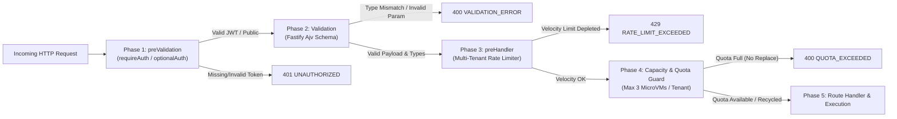

# Atelier Backend Service

Fastify + TypeScript Cloud-Native Agent Backend providing multi-tenant execution, live quota discovery, E2B Linux microVM management, and SSE prompt streaming.

---

## 🛡️ API Architecture & Security Pipeline

Every endpoint in this service implements an end-to-end, multi-stage security and validation pipeline:



### 1. Phase 1: Cryptographic JWT Verification (`preValidation`)
* Implemented in [`src/middleware/auth.middleware.ts`](src/middleware/auth.middleware.ts).
* Authenticated routes declare `preValidation: [requireAuth]`.
* Validates HMAC-SHA256 signature with 7-day expiration via `tokenUtil.verifyJwt`.
* Binds `req.userId`, `req.userEmail`, and `req.token`.
* Rejects missing or invalid credentials immediately with `401 UNAUTHORIZED`.

### 2. Phase 2: Schema & Parameter Validation (`Validation`)
* Runs immediately after authentication and before rate limit token consumption.
* Strict JSON Schemas declared on `params`, `querystring`, and `body`.
* Enforces exact types:
  * Boolean fields (`replaceOldest`, `includeMessages`, `clearAllSessions`, `enabled`, `clear`) reject numbers, objects, or invalid strings.
  * Required fields (`prompt`, `selectedModel`, `sessionId`, `sandboxId`, `code`, `command`, `platform`) reject empty/missing payloads.
* Emits standardized `{ success: false, error: { code: 'VALIDATION_ERROR', message: '...', details: [...] } }`.

### 3. Phase 3: Calibrated Multi-Tenant Rate Limiting (`preHandler` - Velocity)
* Implemented in [`src/middleware/rate-limit.middleware.ts`](src/middleware/rate-limit.middleware.ts) and [`src/modules/rate-limit/rate-limit.service.ts`](src/modules/rate-limit/rate-limit.service.ts).
* Controls **request velocity** (requests permitted within a 1-minute sliding window).
* Rate limits are multi-tenant isolated: keyed by `user:<userId>` for authenticated users (preventing cross-user starvation) and `ip:<ip>` for anonymous visitors.
* Calibrated across 6 distinct tiers:

| Tier | Limiter Instance | Window & Limit | Description | Covered Endpoints |
| :--- | :--- | :---: | :--- | :--- |
| **Tier 1: Cloud Provisioning** | `sandboxProvisionLimiter` | **5 req / min** | Protects expensive cloud Linux microVM compute | `POST /api/v1/sandbox/create` |
| **Tier 2: AI Execution** | `agentPromptLimiter` | **20 req / min** | Protects LLM execution loops & SSE streaming | `POST /api/v1/agent/prompt/stream` |
| **Tier 3: Auth Sensitive** | `authSensitiveLimiter` | **20 req / min** | Prevents credential brute-forcing & device code minting | `POST /api/v1/auth/google`, `/auth/login`, `/auth/refresh`, `/auth/device/*`, `/auth/cli/*/code` |
| **Tier 4: State Mutations** | `mutationLimiter` | **60 req / min** | State updates, session CRUD, attachments, stops | `POST/DELETE /api/v1/sessions`, `/sessions/:id`, `/agent/stop`, `/sandbox/execute`, `/sandbox/attach`, `/sandbox/detach`, `DELETE /sandbox`, `/auth/profile`, `/auth/connect`, `/auth/logout`, `/auth/cli/*/unlink`, `/quota/*/record`, `/debug/logging` |
| **Tier 5: Read APIs** | `readApiLimiter` | **120 req / min** | High-frequency queries, file tree, usage, quotas | `GET /api/v1/sessions`, `/sessions/:id`, `/sessions/:id/messages`, `/sandbox/files`, `/sandbox/file`, `/sandbox/usage`, `/agent/models`, `/quota/*`, `/auth/me`, `/auth/cli/status` |
| **Tier 6: Public Endpoints** | `publicLimiter` | **120 req / min** | Public config, logs, status | `GET /api/v1/auth/config`, `/sandbox/logs`, `/rate-limit/status`, `/debug/logging`, `/oauth2callback` |

### 4. Phase 4: Per-Tenant Resource Capacity & Quota Guard (`Capacity & Concurrency`)
* Implemented in [`src/modules/sandbox/e2b-sandbox.provider.ts`](src/modules/sandbox/e2b-sandbox.provider.ts#L545) and domain services.
* While Phase 3 bounds **velocity** (requests per minute), Phase 4 bounds **total stateful capacity & concurrency** (total cloud compute allocated to a single tenant):
  * **MicroVM Sandbox Ceiling**: Capped at **`3 sandboxes per user`** (`MAX_SANDBOXES_PER_USER = 3`).
  * **Quota Enforcement**: When a user already holds 3 microVMs and requests `POST /api/v1/sandbox/create`:
    * If `replaceOldest === true`: Automatically terminates (`sandbox.kill()`) and releases the user's oldest sandbox slot to provision the new VM.
    * If `replaceOldest === false` (default): Immediately rejects with `400 Bad Request` and code `QUOTA_EXCEEDED`:
      `"Sandbox quota limit reached (3/3 full). Please delete an existing sandbox using the trash icon to free a quota slot before creating a new one."`
  * Guarantees that even within permitted rate limits, a single tenant can never inflate cloud compute bills or monopolize provider resources.

### 5. Standard Response Headers
Every API response emits:
* `X-RateLimit-Limit`: Maximum requests permitted within the 1-minute sliding window.
* `X-RateLimit-Remaining`: Remaining request tokens in current window.
* `X-RateLimit-Reset`: Unix epoch timestamp (seconds) when quota refreshes.
* `Retry-After`: Required wait time in seconds emitted with HTTP 429 when rate limit is exceeded.

---

## 📖 Interactive API Documentation (Swagger / OpenAPI 3.0)

Interactive API documentation with built-in request execution and JWT authorization is served live:
* **Swagger UI**: `http://localhost:4000/api/docs/`
* **OpenAPI 3.0 Specification**: `http://localhost:4000/api/docs/json`

---

## 🚀 Development & Build

```bash
# Start development server with hot-reload (tsx + nodemon)
npm run dev

# Run TypeScript type check
npm run lint

# Compile production bundle
npm run build

# Start production server
npm start
```
