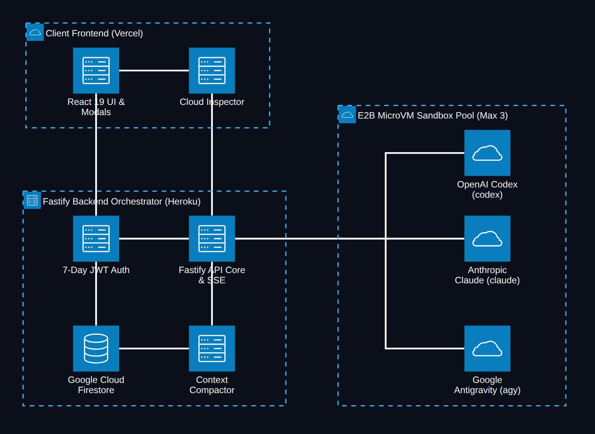
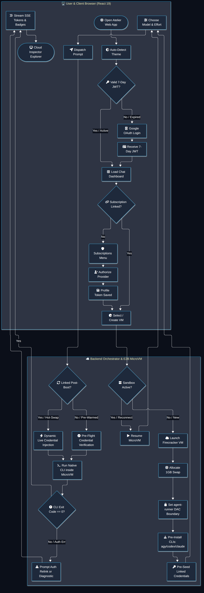
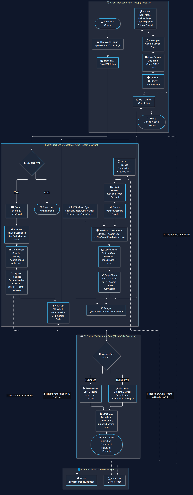
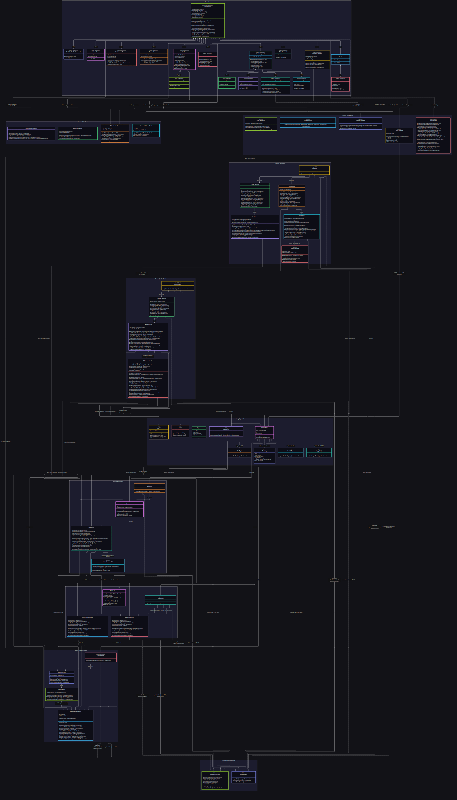
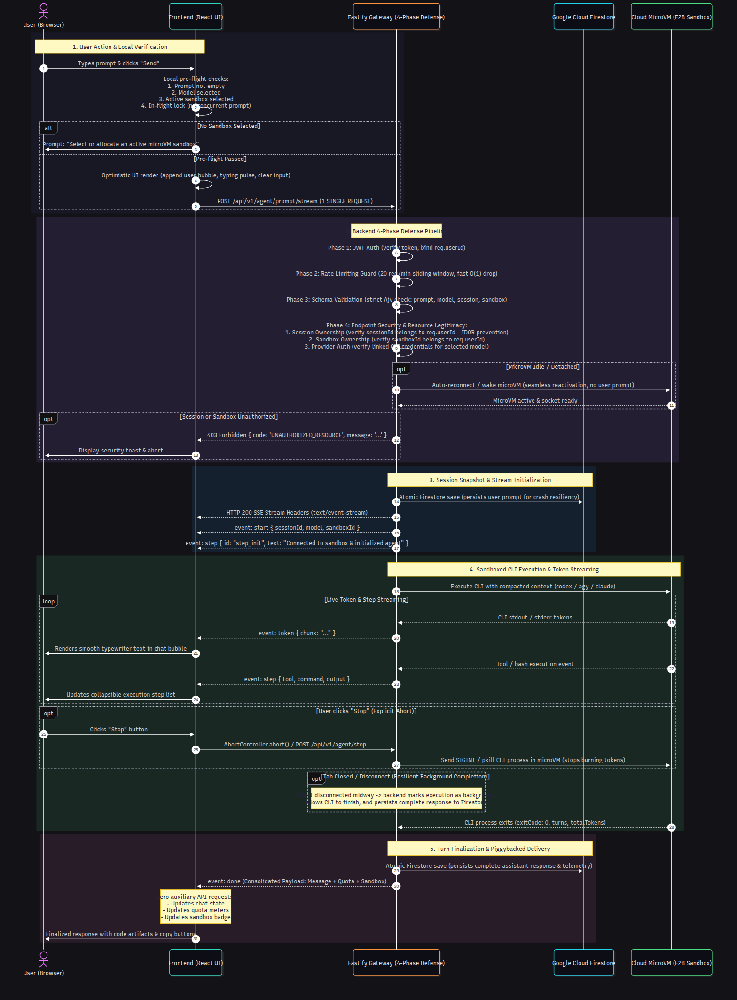
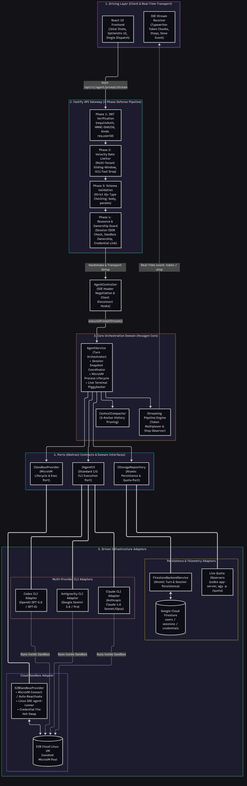
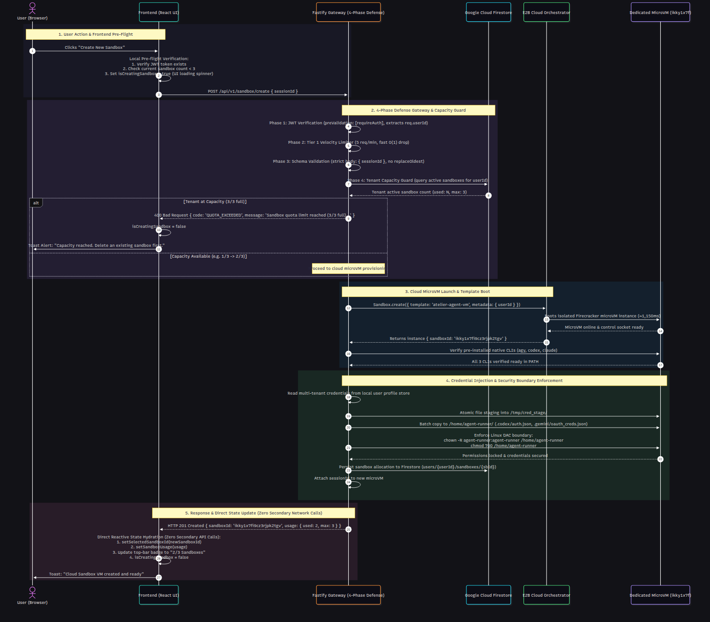
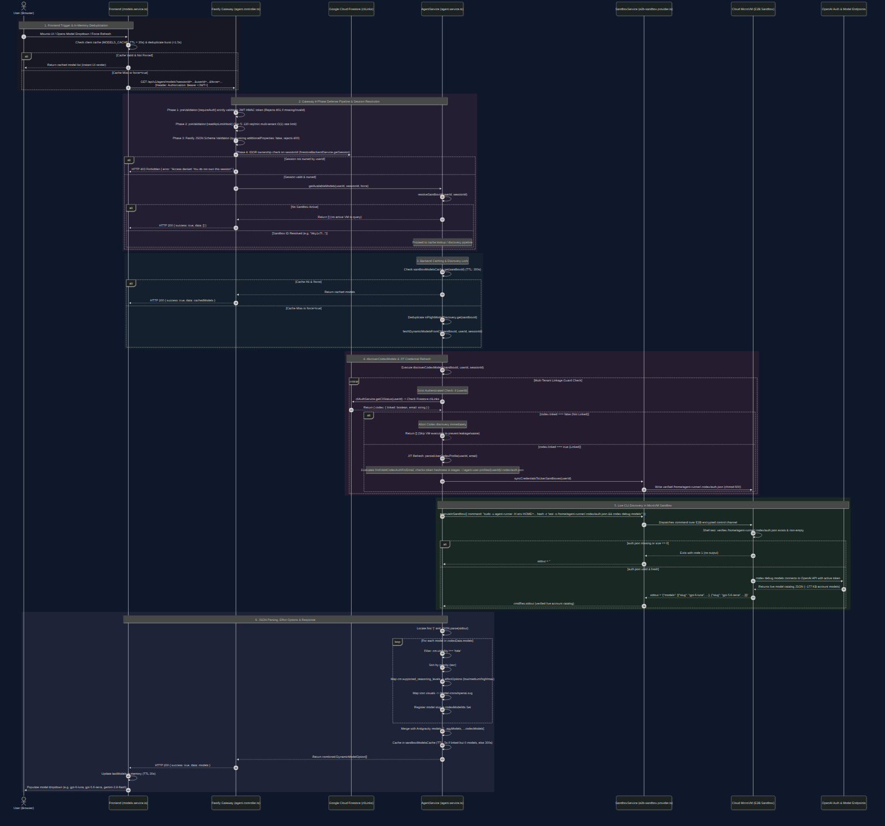

# System Architecture & User Flow Visualizations

This directory contains modern, dark-themed vector diagrams generated via Mermaid (`mmdc`) documenting the system architecture and end-to-end user lifecycle of the Integrated Web UI platform.

---

## 🚀 How to View the Diagrams

You can view these diagrams in three convenient ways:

1. **Interactive In-Browser Viewer (Recommended):**
   Open the included interactive dashboard in Google Chrome or your default browser:
   ```bash
   google-chrome backend/visualizations/index.html
   # or
   xdg-open backend/visualizations/index.html
   ```
   This gives you tabbed navigation between diagrams, high-definition zoom/pan, and one-click SVG/PNG export buttons.

2. **In Antigravity IDE / VS Code:**
   - Open this file ([`visualizations/README.md`](file:///home/psychopomp3012/Projects/Integrated-Web-UI/visualizations/README.md)) and press **`Ctrl+Shift+V`** (or click the **Markdown Preview** button in the top-right corner of the editor tab).
   - Or click directly on the image files in the sidebar file tree:
     - [`architecture-diagram.svg`](file:///home/psychopomp3012/Projects/Integrated-Web-UI/visualizations/architecture-diagram.svg) / [`architecture-diagram.png`](file:///home/psychopomp3012/Projects/Integrated-Web-UI/visualizations/architecture-diagram.png)
     - [`user-flow-diagram.svg`](file:///home/psychopomp3012/Projects/Integrated-Web-UI/visualizations/user-flow-diagram.svg) / [`user-flow-diagram.png`](file:///home/psychopomp3012/Projects/Integrated-Web-UI/visualizations/user-flow-diagram.png)
     - [`codex-auth-flow.svg`](file:///home/psychopomp3012/Projects/Integrated-Web-UI/visualizations/codex-auth-flow.svg) / [`codex-auth-flow.png`](file:///home/psychopomp3012/Projects/Integrated-Web-UI/visualizations/codex-auth-flow.png)
     - [`single-call-sequence.svg`](file:///home/psychopomp3012/Projects/Integrated-Web-UI/visualizations/single-call-sequence.svg) / [`single-call-sequence.png`](file:///home/psychopomp3012/Projects/Integrated-Web-UI/visualizations/single-call-sequence.png)
     - [`hexagonal-architecture.svg`](file:///home/psychopomp3012/Projects/Integrated-Web-UI/visualizations/hexagonal-architecture.svg) / [`hexagonal-architecture.png`](file:///home/psychopomp3012/Projects/Integrated-Web-UI/visualizations/hexagonal-architecture.png)

3. **From the Terminal / Native Image Viewer:**
   ```bash
   xdg-open visualizations/architecture-diagram.png
   xdg-open visualizations/user-flow-diagram.png
   xdg-open visualizations/codex-auth-flow.png
   xdg-open visualizations/single-call-sequence.png
   xdg-open visualizations/hexagonal-architecture.png
   ```

---

## 1. System Architecture Diagram (`architecture-beta`)

Built strictly with Mermaid's native **`architecture-beta`** syntax matching the cloud-only execution model:
- **`group client(cloud)`**: React 19 Frontend UI (with custom modals & Tailwind v3 design tokens) & Cloud Inspector telemetry client hosted on **Vercel**.
- **`group backend(server)`**: Fastify API core & SSE streaming, 7-day JWT auth guard, **Context Compactor** (stitching past conversation turns into one-shot CLI prompts), and **Google Cloud Firestore** (persisting user profiles, active 7-day sessions, linked CLI credentials, conversation messages, and sandbox allocations with zero host disk usage) hosted on **Heroku**.
- **`group sandbox(cloud)`**: Dedicated E2B MicroVM Sandbox Pool (up to 3 microVMs per user) housing the isolated AI CLIs (**Google Antigravity (`agy`)**, **OpenAI Codex (`codex`)**, and **Anthropic Claude (`claude`)**) under DAC `agent-runner` security boundary with zero peer-to-peer coupling.
- **Fastify Core to Sandbox Connection**: A single unified dispatch line from `Fastify API Core` into the E2B Sandbox entry point, which branches to the respective CLI environment.
- **Directional Port Pinning**: Precision rectilinear grid edges using Mermaid port connectors (`:T`, `:B`, `:L`, `:R`) with pure white paths (`#ffffff`) and zero line crossing.



---

## 2. End-to-End User Flow Diagram (`flowchart TD`)

Built with Mermaid's **`flowchart TD`** visual decision engine featuring native FontAwesome iconography and condition branches:
- **Session & Identity**: OS theme auto-detection (`fa:fa-adjust`) and 7-day JWT auth check (`fa:fa-key`) with Google OAuth fallback.
- **Subscription Linking Flow**: Zero-key account linking via provider OAuth (`fa:fa-shield`, `fa:fa-user-check`), unlocking AI providers in the model menu.
- **Sandbox-Coupled Model Discovery**:
  - **No VM Running**: Prompts user that a Sandbox VM is required (`fa:fa-rocket`) with one-click creation.
  - **VM Active but Detached**: Prompts user to select and attach an existing sandbox microVM (`fa:fa-link-slash`) to the current chat session.
  - **VM Attached**: Automatically executes live CLI discovery inside the microVM (`agy models`, `codex debug models`, and live quota queries) strictly adhering to the zero-hardcode and zero-Firestore volatile limit rules.
  - **Dynamic Model Selection**: Renders discovered models with supported reasoning effort levels (`fa:fa-sliders`) and live quota gauges (5h rolling & weekly window for Antigravity, rolling limit for Codex).
- **Multi-Sandbox Pooling & Sharing**: Sandbox decision branch (`fa:fa-cubes`):
  - **Manage / Delete**: Custom Red Delete Modal (`fa:fa-trash-alt`) prompting quota slot release and workspace cleanup in Firestore (`fa:fa-minus-circle`).
  - **Attach Existing**: Multiplexes and shares active microVM workspace across multiple chats (`fa:fa-link`).
  - **Create New**: Firecracker microVM launch (`fa:fa-cloud`), 1GB swap allocation (`fa:fa-microchip`), DAC isolation boundary (`fa:fa-lock`), and pre-warmed credentials.
- **One-Shot Execution & Compaction**:
  - Fetches message history from Cloud Firestore (`fa:fa-database`).
  - Context Compactor stitches previous turns into structured one-shot prompt payload (`fa:fa-compress-arrows-alt`).
  - Dynamic live credential injection if linked post-boot (`fa:fa-bolt`) or pre-flight verification (`fa:fa-check-circle`).
- **Execution & Observability**: Native one-shot CLI execution inside MicroVM (`fa:fa-terminal`), exit code validation (`fa:fa-question-circle`), saving response turns to Firestore (`fa:fa-save`), real-time SSE token stream (`fa:fa-stream`), and live Cloud Inspector file & telemetry viewing (`fa:fa-desktop`).



---

## 3. Codex Multi-Tenant Device Auth Flow (`flowchart TD`)

Built with Mermaid's **`flowchart TD`** documenting the zero-race-condition headless device auth handshake:
- **Client Browser & Auth Popup**:
  - User initiates "Link Codex" (`fa:fa-user`).
  - Browser opens popup `/api/v1/auth/cli/codex/login` with 7-day JWT token (`fa:fa-window-maximize`, `fa:fa-id-card`).
  - Dark-mode helper page auto-displays one-time user code (`fa:fa-copy`) and auto-opens OpenAI device page (`fa:fa-external-link-alt`).
  - User pastes code into OpenAI and grants ChatGPT authorization (`fa:fa-paste`, `fa:fa-check-circle`).
  - Browser polls completion and closes popup upon linkage (`fa:fa-check-double`).
- **Fastify Backend Orchestrator (Multi-Tenant Isolation)**:
  - Validates JWT and extracts user identity (`fa:fa-shield-halved`, `fa:fa-users`).
  - Allocates dedicated session in `activeCodexLogins` Map keyed by `userId` to eliminate multi-user race conditions (`fa:fa-network-wired`).
  - Provisions per-user isolated directory `~/.agent-codex-auth/{userId}` (`fa:fa-folder-plus`).
  - Executes headless `@openai/codex login --device-auth` with `CODEX_HOME` and `HOME` isolated to that user directory (`fa:fa-terminal`).
  - Intercepts stdout to extract verification URL and code for the popup (`fa:fa-filter`).
  - Awaits process completion (`fa:fa-clock-rotate-left`), extracts authenticated email from `auth.json` (`fa:fa-file-shield`, `fa:fa-id-badge`).
  - Persists token to multi-tenant profile storage: `~/.agent-user-profiles/{userId}/.codex/auth.json` (`fa:fa-database`).
  - Updates Firestore linkage state: `codex.linked = true` (`fa:fa-cloud-upload-alt`).
  - Securely purges temporary auth directory: `rm -rf ~/.agent-codex-auth/{userId}` (`fa:fa-broom`).
  - Dispatches `syncCredentialsToUserSandboxes` (`fa:fa-arrows-rotate`).
- **E2B MicroVM Sandbox Boundary**:
  - Hot-swaps credentials into running user microVMs at `/home/agent-runner/.codex/auth.json` (`fa:fa-bolt`).
  - Pre-warms future microVMs from persistent user profile on boot (`fa:fa-snowflake`).
  - Strictly enforces Linux DAC permissions: `chown -R agent-runner:agent-runner` and `chmod 700` (`fa:fa-lock`).
  - Enables prompt execution strictly within the cloud MicroVM (`fa:fa-play`).



---

## 4. Master Codebase Class Diagram (`classDiagram`)

A complete, high-fidelity class diagram spanning both **Frontend** and **Backend**, leaving **zero classes, methods, or functions untouched** (18 Classes, 262 Methods, 177 Functions):
- **Core Backend Services & Providers**: Fastify route plugins, controllers, `AgentService`, `SandboxService`, `E2BSandboxProvider`, `AntigravityQuotaService`, `CodexQuotaService`, and `FirestoreBackendService`.
- **Frontend Component Hierarchy**: React 19 root (`App`), Header, Sidebar, PromptBar, CloudInspector, AuthModal, ModelSelectorDropdown, MarkdownContent, CodeArtifact, and SlashCommandPalette.
- **Client Services & Reactive State**: `CliAuthServiceClient`, `FirestoreServiceClient`, `ModelsServiceClient`, `SessionSyncServiceClient`, and Jotai state atoms.
- **Cross-Stack Bridges**: SSE streaming transport and Firestore document schema synchronization.



---

## 5. Backend Architecture & Class Structure (`classDiagram`)

Detailed inspection of the backend module layer:
- **Controllers**: `AgentController`, `AuthController`, `CliAuthController`, `SandboxController`, `SessionController`, `HealthController`.
- **Services**: `AgentService`, `AuthService`, `CliAuthService`, `SandboxService`, `SessionService`, `AntigravityQuotaService`, `CodexQuotaService`, `RateLimitService`, `FirestoreBackendService`.
- **Providers**: `E2BSandboxProvider` (active cloud microVM provider) and `DockerSandboxProvider` (dead local provider).
- **Core Utilities**: `ContextCompactor`, `TokenUtil_Backend`, `IdUtil`, `LoggerUtil`, `ResponseUtil`, `AppError`.


---

## 6. Frontend Component & Service Hierarchy (`classDiagram`)

Detailed mapping of the client architecture:
- **Component Layer**: All 18 React components with their event handlers, subcomponents, and prop signatures.
- **Service Layer**: Dedicated client API wrappers for CLI device auth, Firebase authentication, Firestore persistence, and model discovery.
- **Utility Modules**: API fetch helpers, slash command parsers, quota badge formatters, and token metric calculators.
- **Reactive State**: Jotai primitive atoms managing user identity, active sandboxes, session pagination, and quota states.


---

## 7. Code Redundancy & Dead Code Analysis Diagram (`classDiagram`)

Visual breakdown mapping discovered code redundancies, dead classes, and legacy endpoints:


---

## 8. Comprehensive Code Redundancy & Refactoring Report

Our static AST analysis and symbol cross-referencing uncovered several high-priority redundancies and dead code paths across the codebase:

| # | Component / Symbol | File Location | Issue Description | Impact & Recommended Action |
|---|-------------------|---------------|-------------------|-----------------------------|
| **1** | `DockerSandboxProvider` | [`backend/src/modules/sandbox/docker-sandbox.provider.ts`](file:///home/psychopomp3012/Projects/Integrated-Web-UI/backend/src/modules/sandbox/docker-sandbox.provider.ts) | Contains **23 methods and ~700 lines of code** implementing local Docker containers. The platform is strictly mandated to be **cloud-only** using E2B MicroVMs (`.agents/AGENTS.md`). | **Dead Code**: Completely unused in cloud execution. `sandbox.service.ts` instantiates it as a dormant field. **Action**: Remove `DockerSandboxProvider` or isolate it to an optional development-only flag. |
| **2** | Rate Limit Endpoint `/api/v1/rate-limit/status` | `backend/src/modules/rate-limit/rate-limit.routes.ts` | Endpoint returned local Fastify rate limiter metrics rather than AI capacity. Never rendered in UI. | **Removed**: Cleaned up from backend routes, Swagger spec, and docs. Anti-flood protection remains enforced via internal hooks. |
| **3** | `fetchQuota()` in Frontend | [`frontend/src/App.tsx`](file:///home/psychopomp3012/Projects/Integrated-Web-UI/frontend/src/App.tsx) | Proactively polled `/api/v1/rate-limit/status` on mount and ran a 1-second interval loop. | **Removed**: Completely eliminated from frontend mount and state loops. 429 errors and SSE stream events handle rate limits reactively. |
| **4** | Duplicate Quota Exhaustion Logic | [`frontend/src/components/ModelSelectorDropdown.tsx:70-100`](file:///home/psychopomp3012/Projects/Integrated-Web-UI/frontend/src/components/ModelSelectorDropdown.tsx#L70-L100) vs [`frontend/src/utils/quota.util.ts`](file:///home/psychopomp3012/Projects/Integrated-Web-UI/frontend/src/utils/quota.util.ts) | `ModelSelectorDropdown` implements inline functions (`isGroupExhausted`, `isModelQuotaExhausted`, `getModelQuotaDescription`) that duplicate functions in `quota.util.ts`. | **Duplicate Code**: Violates DRY principles. Changes to quota formatting require updating both places. **Action**: Refactor `ModelSelectorDropdown` to import directly from `quota.util.ts`. |
| **5** | Confusing `token.util.ts` Nomenclature | `backend/src/utils/token.util.ts` vs `frontend/src/utils/token.util.ts` | Backend `token.util.ts` handles **JWT authorization**, while frontend `token.util.ts` computes **LLM token metrics**. | **Nomenclature Conflict**: Confusing to engineers reviewing full-stack code. **Action**: Rename frontend utility to `llm-token-metrics.util.ts`. |
| **6** | Dual Session Persistence Pathways | `frontend/src/services/sessionSync.service.ts` vs `frontend/src/services/firestore.service.ts` | Frontend has two parallel ways of saving chat data: via backend REST `/api/v1/sessions` and via direct client Firestore SDK writes. | **Architectural Divergence**: `.agents/AGENTS.md` states: *"Never perform data storing operations directly via frontends"*. **Action**: Standardize all chat persistence through the backend Fastify API gateway. |

> 📖 **Comprehensive Audit Document**: For full technical details and actionable remediation plans for each issue above, see [**`visualizations/codebase-discrepancies.md`**](file:///home/psychopomp3012/Projects/Integrated-Web-UI/visualizations/codebase-discrepancies.md).

---

## 9. Single-Call Consolidated Agent Sequence (`sequenceDiagram`)

Detailed end-to-end interaction sequence for consolidated single-call agent streaming:
- **Pre-flight Frontend Guard**: Verifies active sandbox selection before dispatching.
- **4-Phase Defense Pipeline**:
  - Phase 1: Strict HMAC-SHA256 JWT auth binding `req.userId`.
  - Phase 2: Multi-tenant velocity rate limiting ($O(1)$ fast rejection before body parsing).
  - Phase 3: Strict Ajv schema parameter validation.
  - Phase 4: Session ownership IDOR defense and E2B microVM connectivity/auto-reactivation.
- **Resilient Turn Execution**: User prompt persisted upfront, assistant reply persisted at completion, and piggybacked terminal status & quota bundled in `event: done`.
- **Decoupled Client Disconnect**: If user navigates away or disconnects, backend streaming detaches while cloud execution runs to completion in the microVM.



---

## 10. Feature-Sliced Hexagonal Architecture (`flowchart`)

Ports & Adapters architectural blueprint designed specifically for high-throughput AI agent execution:
- **Driving Transport Layer**: React 19 Frontend (Jotai state, typewriter token consumer) communicating over SSE.
- **4-Phase Defense Gateway**: Strict Fastify preValidation and validation barrier guarding all inward traffic.
- **Core Orchestration Domain (Hexagon Core)**: `AgentService` orchestrator, `ContextCompactor` (3-anchor pruning), and streaming pipeline engine.
- **Abstract Ports**: Defined TypeScript contracts for sandbox providers (`ISandboxProvider`), agent CLIs (`IAgentCli`), and persistence/telemetry (`IStorageRepository`).
- **Driven Infrastructure Adapters**: Isolated implementations for E2B microVMs, Codex CLI, Antigravity CLI, Claude CLI, Google Cloud Firestore, and live CLI quota observers.



---

## 11. Cloud Sandbox MicroVM Provisioning Lifecycle (`sequenceDiagram`)

Detailed end-to-end lifecycle when a user provisions a new dedicated cloud sandbox:
- **Phase 1: User Initiation & Pre-flight**: Authenticated client checks local quota cap (<3) and sets optimistic loading state (`isCreatingSandbox = true`).
- **Phase 2: 4-Phase Defense Gateway & Strict Capacity Guard**: Strict JWT auth (`requireAuth`), Tier 1 velocity rate limiting (5 req/min fast $O(1)$ drop), Ajv schema validation (body strictly accepts `{ sessionId }`, with `replaceOldest` eliminated), and multi-tenant Firestore capacity check (max 3 sandboxes per tenant; strictly returns `QUOTA_EXCEEDED` 400 if full, never replacing or deleting existing sandboxes).
- **Phase 3: Cloud MicroVM Spin-up**: E2B Firecracker microVM spawned from template `atelier-agent-vm` (~1,150ms boot time) with pre-installed CLI verification (`agy`, `codex`, `claude`).
- **Phase 4: Credential Injection & Security Boundary**: Multi-tenant credential files (`.codex/auth.json`, `.gemini/oauth_creds.json`) staged and copied to `/home/agent-runner/`, followed by strict Linux DAC lockdown (`chown -R agent-runner:agent-runner /home/agent-runner && chmod 700 /home/agent-runner`).
- **Phase 5: Streamlined Response & Direct State Hydration**: Fastify Gateway returns `201 Created` with `{ sandboxId, usage: { used: 2, max: 3 } }`. Frontend immediately updates `activeSandboxAtom`, `sandboxUsageAtom`, and the top-bar badge with **zero secondary API calls** (eliminating redundant `/usage`, `/models`, and `/quota` probes).



---

## 12. Codex Model Retrieval Sequence (`sequenceDiagram`)

Detailed end-to-end lifecycle when dynamic Codex models are queried from cloud microVM sandboxes:
- **Phase 1: Frontend In-Memory Deduplication**: Frontend checks local 30s cache and deduplicates burst calls within 1.5s before hitting the network.
- **Phase 2: 4-Phase Defense Gateway & Session Resolution**: Strict JWT verification (`preValidation: [requireAuth]`), Tier 5 multi-tenant rate limiting (`readApiLimitHook` 120 req/min), Fastify query schema validation, and Firestore IDOR session ownership verification.
- **Phase 3: Backend Sandbox Models Caching**: `AgentService` checks `sandboxModelsCache` (300s TTL) and deduplicates concurrent in-flight discoveries for the same sandbox.
- **Phase 4: JIT Credential Refresh & Sandbox Staging**: Verifies authenticated `userId` against Firestore. If linked, evaluates `findValidCodexAuthForEmail`, proactively stages fresh credentials into `~/.agent-user-profiles/<userId>/.codex/auth.json`, and writes verified `auth.json` (`0600`) to `/home/agent-runner/.codex/auth.json` in the microVM.
- **Phase 5: Cloud MicroVM Shell Execution**: Runs `sudo -u agent-runner -H env ... bash -c 'test -s /home/agent-runner/.codex/auth.json && codex debug models'` inside the isolated E2B microVM using the fresh authenticated session token.
- **Phase 6: Live Catalog JSON Parsing & Response**: Parses live JSON catalogue from Codex CLI, filters hidden models (`visibility !== 'hide'`), sorts by priority, maps `supported_reasoning_levels` into effort options, and assigns OpenAI visual branding.



---

## 🛠️ Regenerating Visualizations

The diagrams can be regenerated at any time using the pre-configured `mmdc` CLI tool and local puppeteer configuration:

```bash
# Master Codebase Class Diagram (SVG & High-Res PNG)
mmdc -p visualizations/puppeteer-config.json -t redux-dark-color -b "#121217" -i visualizations/codebase-class-diagram.mmd -o visualizations/codebase-class-diagram.svg
mmdc -p visualizations/puppeteer-config.json -t redux-dark-color -b "#121217" -i visualizations/codebase-class-diagram.mmd -o visualizations/codebase-class-diagram.png -s 2

# Architecture, User Flow, Codex Auth, Prompt Sequence, Hexagonal, Sandbox & Codex Models Diagrams
mmdc -p visualizations/puppeteer-config.json -t redux-dark-color -b "#121217" -i visualizations/architecture-diagram.mmd -o visualizations/architecture-diagram.svg
mmdc -p visualizations/puppeteer-config.json -t redux-dark-color -b "#121217" -i visualizations/user-flow-diagram.mmd -o visualizations/user-flow-diagram.svg
mmdc -p visualizations/puppeteer-config.json -t redux-dark-color -b "#121217" -i visualizations/codex-auth-flow.mmd -o visualizations/codex-auth-flow.svg
mmdc -p visualizations/puppeteer-config.json -t redux-dark-color -b "#121217" -i visualizations/single-call-sequence.mmd -o visualizations/single-call-sequence.svg
mmdc -p visualizations/puppeteer-config.json -t redux-dark-color -b "#121217" -i visualizations/single-call-sequence.mmd -o visualizations/single-call-sequence.png -s 2
mmdc -p visualizations/puppeteer-config.json -t redux-dark-color -b "#121217" -i visualizations/hexagonal-architecture.mmd -o visualizations/hexagonal-architecture.svg
mmdc -p visualizations/puppeteer-config.json -t redux-dark-color -b "#121217" -i visualizations/hexagonal-architecture.mmd -o visualizations/hexagonal-architecture.png -s 2
mmdc -p visualizations/puppeteer-config.json -t redux-dark-color -b "#121217" -i visualizations/sandbox-provision-sequence.mmd -o visualizations/sandbox-provision-sequence.svg
mmdc -p visualizations/puppeteer-config.json -t redux-dark-color -b "#121217" -i visualizations/sandbox-provision-sequence.mmd -o visualizations/sandbox-provision-sequence.png -s 2
mmdc -p visualizations/puppeteer-config.json -t redux-dark-color -b "#121217" -i visualizations/codex-model-retrieval-sequence.mmd -o visualizations/codex-model-retrieval-sequence.svg
mmdc -p visualizations/puppeteer-config.json -t redux-dark-color -b "#121217" -i visualizations/codex-model-retrieval-sequence.mmd -o visualizations/codex-model-retrieval-sequence.png -s 2
```


