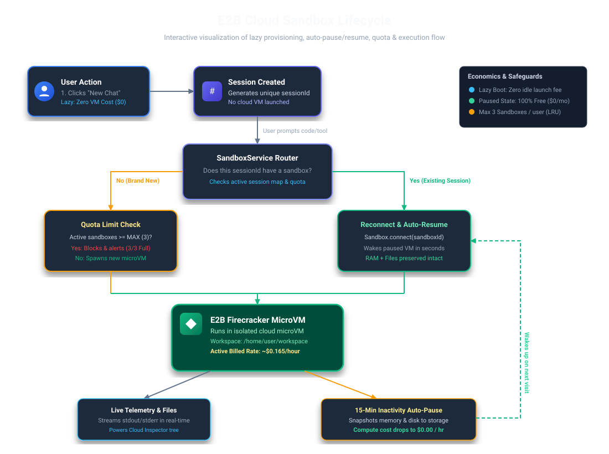
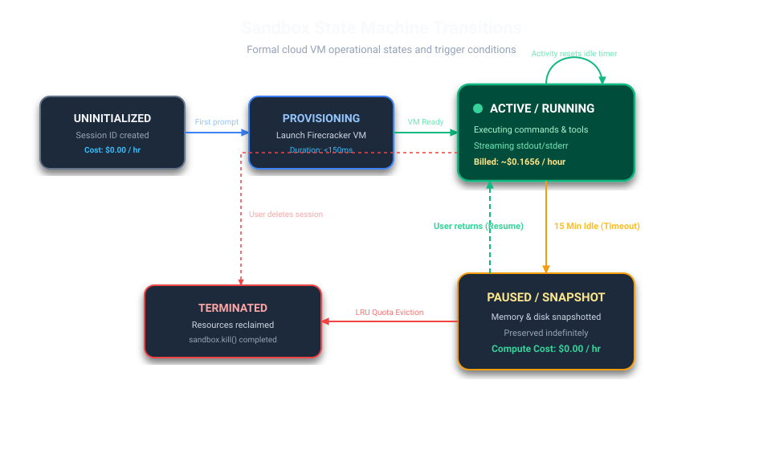
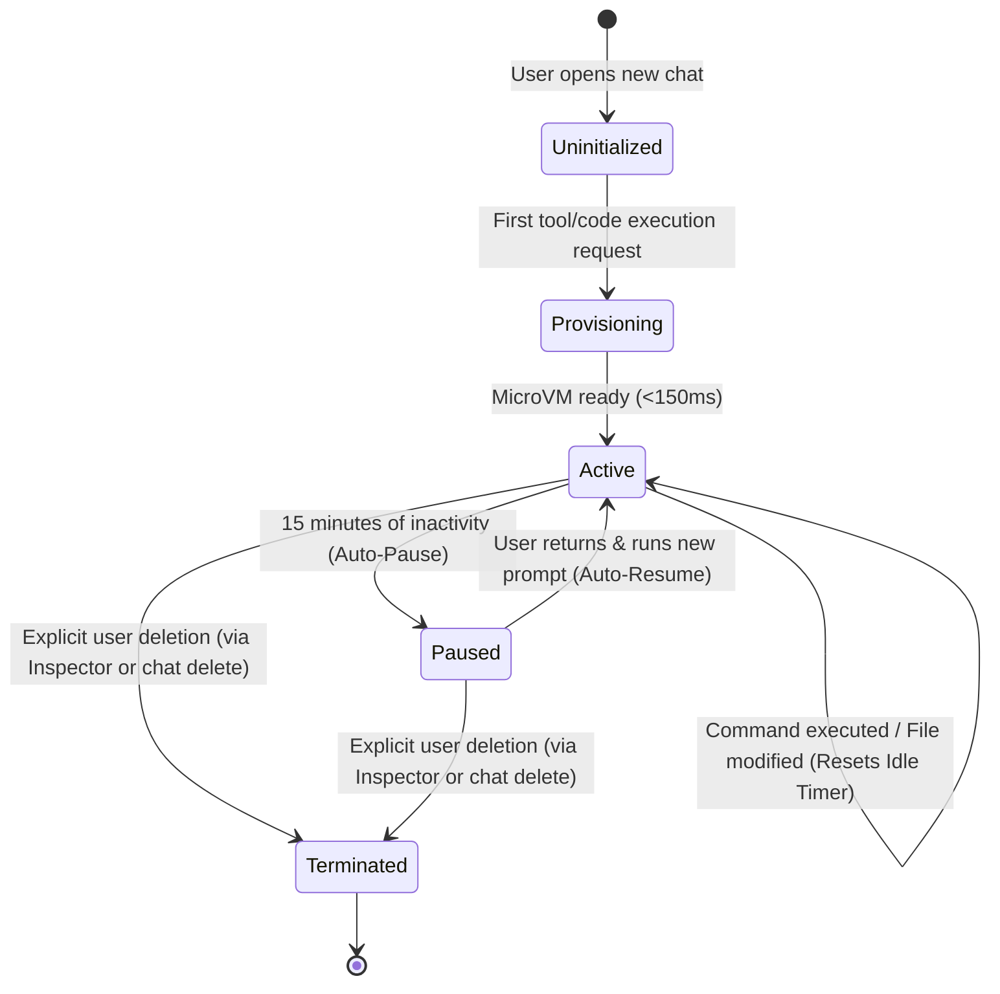
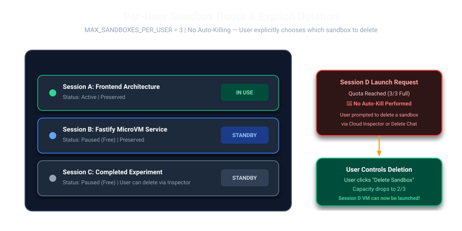

# E2B Sandbox Lifecycle & Economics Architecture

> **Visual Assets Available:**
> - 📊 **Interactive HTML Dashboard**: [sandbox-lifecycle.html](./sandbox-lifecycle.html) (Open in any browser for interactive slider and live cost calculations)
> - 🖼️ **Vector Flowchart (SVG)**: [lifecycle-flowchart.svg](./lifecycle-flowchart.svg)
> - 🔄 **State Machine (SVG)**: [state-machine.svg](./state-machine.svg)
> - 🛡️ **Per-User Quota Engine (SVG)**: [quota-eviction.svg](./quota-eviction.svg)

---

## 1. What Happens When a User Creates a New Session?

### The Principle: Lazy, On-Demand MicroVM Provisioning
When a user clicks **"New Chat"** or initiates a new conversation session:
1. **Session Initialization (Instant & Free)**:
   - A new unique `sessionId` (e.g. `sess_12345678`) is created in the frontend and state store.
   - **No cloud sandbox is provisioned yet.** This ensures users who open sessions to read past history, tweak prompt settings, or browse models do not incur any cloud compute cost or consume concurrency limits.

2. **First Prompt / Code Execution (Trigger Point)**:
   - When the user sends their first instruction that requires agent execution or tool invocation (or when the Cloud Inspector / file tree is accessed), `sandboxService.getOrCreateSandbox(sessionId, userId)` is triggered.
   - If the user already has a running or paused sandbox for this session, it connects or auto-resumes.
   - If this is a new session without an existing sandbox, a dedicated Firecracker microVM is spun up in <150ms.

3. **Returning to an Existing Session**:
   - When the user clicks an older chat in the sidebar, the backend retrieves the mapped `sandboxId`.
   - If the sandbox was idle and automatically suspended by E2B, calling `Sandbox.connect(sandboxId)` automatically resumes the exact same VM state—including all files, installed dependencies (`pip`/`npm`), and git repositories.

---

## 2. End-to-End Lifecycle Flowchart



```mermaid
flowchart TD
    classDef client fill:#3b82f6,stroke:#1d4ed8,stroke-width:2px,color:#fff;
    classDef server fill:#6366f1,stroke:#4338ca,stroke-width:2px,color:#fff;
    classDef cloud fill:#10b981,stroke:#047857,stroke-width:2px,color:#fff;
    classDef storage fill:#f59e0b,stroke:#b45309,stroke-width:2px,color:#fff;

    User([User in Frontend]):::client -->|1. Creates New Chat| SessionInit[Generate Session ID<br/>No Sandbox Created Yet]:::server
    User -->|2. Sends First Code/Agent Prompt| BackendReq[Fastify Backend<br/>agentService / sandboxService]:::server
    
    BackendReq --> CheckExisting{Sandbox exists<br/>for this sessionId?}:::server
    
    CheckExisting -->|Yes| CheckRunning{Is Sandbox<br/>Currently Running?}:::server
    CheckRunning -->|Yes| ExecDirect[Execute Command / Code]:::cloud
    CheckRunning -->|No (Paused)| ResumeVM[Sandbox.connect: Auto-Resume<br/>Restores RAM + Filesystem]:::cloud
    ResumeVM --> ExecDirect
    
    CheckExisting -->|No| CheckExistingSandboxes{User has active<br/>sandbox available?}:::server
    CheckExistingSandboxes -->|Yes (Default)| AttachExisting[Attach Chat Session to Existing Sandbox<br/>Multi-Session Shared Workspace]:::server
    AttachExisting --> ExecDirect
    
    CheckExistingSandboxes -->|No / Wants New| CheckQuota{User Sandbox Count<br/>>= MAX (3)?}:::server
    CheckQuota -->|Yes (3/3 Full)| QuotaFull[Show Quota Limit: 3/3 Full<br/>Work is NEVER Auto-Killed<br/>User Selects Sandbox to Delete]:::server
    QuotaFull -.->|Explicit Delete| DestroySlot[sandbox.kill: Free 1 Slot]:::server
    DestroySlot --> CreateVM
    CheckQuota -->|No (<3)| CreateVM[Sandbox.create<br/>Launch Cloud MicroVM]:::cloud
    
    CreateVM --> ExecDirect
    ExecDirect --> StreamOutput[Stream Execution Logs & Artifacts<br/>To Cloud Inspector & Chat UI]:::client
    
    ExecDirect --> IdleWindow[Idle Clock Starts<br/>timeoutMs = 15 Minutes]:::storage
    IdleWindow -->|User Sends Next Prompt| ResetClock[Clock Resets<br/>Keep Alive]:::storage
    ResetClock --> ExecDirect
    
    IdleWindow -->|15 Min Inactivity| AutoPause[E2B Auto-Pause<br/>Full Memory + Disk Snapshot<br/>Compute Billing Stops: $0/hr]:::storage
    
    User -->|Deletes Chat Session| DetachSession[Detach Session from Sandbox<br/>Workspace & Files Preserved]:::server
    User -->|Explicit Delete Sandbox| ExplicitKill[sandbox.kill<br/>Permanently Destroy VM & Release Slot]:::server
```

---

## 3. Sandbox State Machine





### State Definitions
* **`Uninitialized`**: Session exists in frontend/database, but zero cloud compute resources are provisioned.
* **`Active / Running`**: Firecracker microVM is running in the E2B cloud. CPU and RAM are allocated. Commands execute with sub-millisecond local speed.
* **`Paused / Snapshotted`**: Triggered automatically after 15 minutes of idle time. RAM and disk are safely snapshotted. **Compute cost drops to $0.00/hour**.
* **`Terminated`**: VM resources are permanently released and reclaimed.

---

## 4. Per-User Sandbox Limit & User-Controlled Deletion



To prevent runaway billing and unbounded cloud resource consumption, our backend enforces a configurable **Per-User Sandbox Limit**:

$$\text{MAX\_SANDBOXES\_PER\_USER} = 3 \quad \text{(Configurable via \texttt{.env})}$$

### Why No Auto-Kill?
Sandboxes store real development work, generated code, installed dependencies, and project artifacts. **Auto-killing inactive sandboxes is unsafe** because it could silently wipe work the user intended to revisit.

### How the Quota Guard Operates:
1. **Real-Time Capacity Indicator (`x/y full`)**:
   - The Cloud Inspector and API report real-time usage (e.g., `Sandboxes: 2/3 active` or `Sandboxes: 3/3 FULL`).
2. **Clear Limit Alert**:
   - When a user already has 3 active sandboxes and attempts to launch a 4th session, the platform **refuses to create a new sandbox** and displays a clear alert:
     > *"Maximum sandbox limit reached (3/3 full). In order to create another one, please delete one of your existing sandboxes."*
3. **Explicit User-Controlled Deletion**:
   - The user has two straightforward ways to release a slot:
     - Click **"Delete Sandbox"** directly inside the Cloud Inspector.
     - Click **"Delete Session"** in the chat sidebar.
   - Once a slot is freed (e.g. dropping to 2/3), the user can immediately launch their new sandbox.

---

## 5. Potential Cost Calculation for Each User

E2B charges **strictly by active compute duration (down to the second)**. Compute charges stop immediately when a sandbox is paused.

### Baseline Pricing Breakdown
| Resource | E2B Base Rate | Per Second Rate |
| :--- | :--- | :--- |
| **2 vCPU** | $0.0504 / vCPU-hour | $0.000014 / vCPU-sec |
| **4 GB RAM** | $0.0162 / GiB-hour | $0.0000045 / GiB-sec |
| **Active 2vCPU + 4GB Sandbox** | **~$0.1656 / hour** | **~$0.000046 / sec** |
| **Paused Sandbox (RAM + Disk Snapshots)** | **$0.00 (FREE)** | **$0.00** |

---

### User Consumption Profiles & Estimated Monthly Cost

#### Profile 1: Casual / Occasional User
* **Usage Pattern**: 5–10 agent prompts per week (quick script generation, math, regex, formatting).
* **Active Execution Time**: ~1–2 minutes per prompt.
* **Auto-pause overhead**: 15 minutes after session completes.
* **Active Compute**: ~3 hours / month.
* **Monthly Cost**:
  $$\text{Cost} = 3 \text{ hours} \times \$0.1656 = \mathbf{\$0.50 \text{ / month}}$$

#### Profile 2: Active Developer (Moderate Daily Usage)
* **Usage Pattern**: 20 active days per month. Works for 1–2 hours interactively with the agent (running tests, generating components, terminal commands).
* **Active Compute**: ~15 to 20 hours / month (sandbox runs only during active coding windows, pausing during meetings/breaks).
* **Monthly Cost**:
  $$\text{Cost} = 18 \text{ hours} \times \$0.1656 = \mathbf{\$2.98 \text{ / month}}$$

#### Profile 3: Power User / Heavy Automation
* **Usage Pattern**: Full-day development pairing, heavy package installations (`npm install`, `pip install`, builds), and multiple long agent tasks.
* **Active Compute**: ~60 hours / month.
* **Monthly Cost**:
  $$\text{Cost} = 60 \text{ hours} \times \$0.1656 = \mathbf{\$9.94 \text{ / month}}$$

#### Profile 4: The Runaway Safety Net (Without vs. With Auto-Pause)
| Metric | Without Auto-Pause (Traditional VM / EC2) | With E2B Auto-Pause + Max 3 Sandboxes |
| :--- | :--- | :--- |
| **Idle Behavior** | Billed 24/7 (720 hrs/mo) | Pauses after 15 min idle ($0/hr) |
| **Forgotten Tabs** | Continues billing indefinitely | Suspended automatically |
| **Monthly Bill** | **$119.23 / user / month** | **~$2.50 – $4.00 / user / month** |
| **Savings** | 0% | **~96% – 98% Cost Reduction** |

---

## 6. Summary of Architectural Safeguards

1. **Zero-Waste Lazy Instantiation**: No microVM is launched until code execution is actually requested.
2. **Auto-Pause State Preservation**: Inactive sandboxes hibernate after 15 minutes, preserving RAM and files for free.
3. **Per-User Quota & LRU Eviction**: Limits each user to a maximum of 3 sandboxes, automatically cleaning up stale containers.
4. **Predictable Unit Economics**: Average user cost is capped at **~$1.00 – $3.50/month**, making the platform highly cost-effective to operate.
